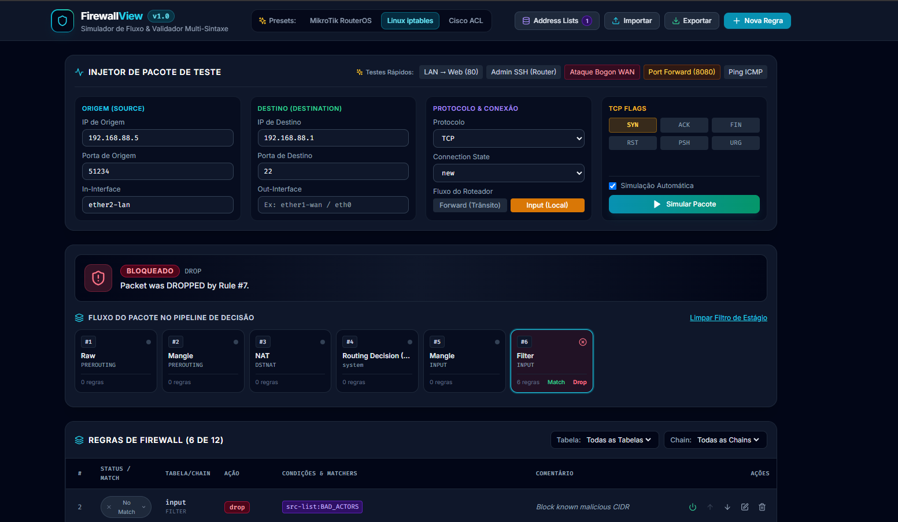

# FirewallView 🛡️

**FirewallView** é uma aplicação moderna, minimalista e visualmente confortável projetada para **simular, inspecionar e testar o fluxo de pacotes através de regras de firewall**.

Ele permite validar previamente como pacotes de rede (TCP, UDP, ICMP, etc.) se comportam diante de tabelas de firewall complexas, analisando cada estágio do pipeline de decisão (Raw, Mangle, NAT, Routing, Filter) e inspecionando o veredito exato (ACCEPT, DROP, REJECT, NAT) e o motivo de match de cada regra.



---

## ✨ Recursos Principais

- **Simulação Interativa de Fluxo (Packet Trace & Inspector)**:
  - Suporte completo aos 3 fluxos L3 de roteador: **Forward** (trânsito), **Input** (destinado ao roteador) e **Output** (originado localmente no roteador).
  - Defina pacotes de teste com IPs de origem/destino, portas, protocolo, interfaces (`in-interface`, `out-interface`), connection states (`new`, `established`, `related`, `invalid`) e flags TCP (`SYN`, `ACK`, `FIN`, `RST`, etc.).
  - Presets rápidos para 1 clique (Acesso Web LAN → WAN, SSH de Admin, Ataque Bogon / Botnet, Port Forwarding NAT, Ping ICMP, Router Output DNS 53).
  - Veredito imediato com destaque visual e detalhamento do motivo de match/mismatch por critério.

- **Persistência Automática no Navegador (localStorage)**:
  - Todo o seu trabalho (equipamento selecionado, regras criadas manualmente, Address Lists e configurações do pacote de teste) é salvo automaticamente no seu navegador.
  - Ao recarregar a página (`F5`), suas alterações são preservadas e o ambiente continua exatamente onde você parou, sem sobrescrever com templates padrões.

- **Suporte Multi-Sintaxe de Firewall**:
  - **MikroTik RouterOS (v6 e v7)**: `/ip firewall filter`, `/ip firewall nat`, `/ip firewall mangle`, `/ip firewall raw`, `/ip firewall address-list`.
  - **Linux iptables & ipset**: Regras `iptables -A ...`, `iptables-save`, `ipset create/add`, suporte a `-m set --match-set`.
  - **nftables**: Sintaxe declarativa e em blocos `table inet filter { chain input { ... } }`, sets (`@list`), hooks e priorities.
  - **Cisco ACL & ASA**: `access-list` standard/extended, named ACLs `ip access-list extended`, e `object-group network`.
  - **Juniper Junos OS**: Sintaxe hierárquica `firewall { family inet { filter ... } }` e comandos `set`, com suporte a `prefix-list`, `terms`, matchers e ações (`accept`, `discard`, `reject`).
  - **Datacom DmOS**: Sintaxe `access-list`, `protection cpu` (CoPP), `acl-profile cpu l3`, `access-list-entry`, matchers de protocolo (números e nomes), portas, serviços, IPs e ações (`permit`, `deny`).

- **Importação honesta (avisos de parse)**:
  - Tudo o que o parser não consegue representar (matcher desconhecido, opção não suportada, aproximação) aparece como **aviso** no modal de importação e em um ícone na regra. Nada é descartado em silêncio: um aviso significa que aquela regra pode casar com mais pacotes do que no equipamento real.
  - Policies padrão de chain (`iptables -P`, `:INPUT DROP`, nft `policy drop;`) e o deny implícito de Cisco/Junos viram regras marcadas como **POLICY**, sempre avaliadas por último na chain.
  - Regras IPv4 e IPv6 são separadas por família (`/ip` vs `/ipv6 firewall`, `ip6tables`, `ip6 saddr`, `family inet6`...).
  - Regras do RouterOS coladas do terminal com linhas quebradas no meio da palavra são reconstruídas automaticamente. Para copiar sem quebras, prefira `/ip firewall export terse`.

- **Gerenciador de Address Lists & IPsets**:
  - Suporte a IPs únicos (`10.0.0.1`), prefixos CIDR (`192.168.0.0/24`), ranges (`10.0.0.1-10.0.0.50`).
  - Testador interativo para verificar se qualquer endereço IP pertence a uma ou mais listas.

- **Importação e Exportação / Conversor de Sintaxes**:
  - Importe scripts ou regras colando o texto ou enviando arquivos (`.rsc`, `.sh`, `.nft`, `.txt`) com **detecção automática** da sintaxe.
  - Exporte ou converta suas regras para qualquer um dos formatos suportados com 1 clique (ex: converta regras de MikroTik para iptables ou Cisco ACL).
  - O exporter **nunca gera uma regra mais ampla ou invertida**: o que o formato de destino não consegue expressar sai como comentário (`UNSUPPORTED` / `NOT EXPORTED`), para revisão manual.

- **Visualizador Visual do Pipeline**:
  - Grafo visual horizontal dos nós do kernel/sistema operacional:
    `PREROUTING (Raw)` ➔ `PREROUTING (Mangle)` ➔ `PREROUTING (Dst-NAT)` ➔ `Routing Decision` ➔ `FORWARD / INPUT (Filter)` ➔ `POSTROUTING (Mangle)` ➔ `POSTROUTING (Src-NAT)`.
  - Exibição de transformações em tempo real (DNAT e SNAT / Masquerade).

- **100% Dockerizado**:
  - Empacotado em um contêiner leve contendo Frontend compilado + Backend FastAPI de alta performance.
  - Roda como usuário sem privilégios, com `HEALTHCHECK` em `/api/health`.

- **Validado contra firewalls reais**:
  - Além dos testes unitários, o simulador é comparado pacote a pacote com o **kernel Linux** (nftables, iptables-nft e iptables-legacy) e com um **MikroTik RouterOS 7 real** (CHR), incluindo fuzzing dos exporters. Veja [Testes](#-testes).

---

## 🚀 Como Executar com Docker

### 1. Início Rápido (Recomendado)

Clone o repositório ou acesse a pasta do projeto e execute:

```bash
./run.sh
```

Ou diretamente via Docker Compose:

```bash
docker compose up -d --build
```

A aplicação estará disponível em:
👉 **[http://localhost:8080](http://localhost:8080)**

Para parar o contêiner:
```bash
docker compose down
```

### 2. Variáveis de ambiente

| Variável | Padrão | Descrição |
|---|---|---|
| `PORT` | `8080` | Porta HTTP dentro do contêiner |
| `FIREWALLVIEW_CORS_ORIGINS` | `*` | Origens permitidas para CORS, separadas por vírgula |

O endpoint de importação aceita até 2 MB por requisição.

---

## 💻 Desenvolvimento Local (Opcional)

Se desejar rodar fora do Docker durante o desenvolvimento:

### Backend (Python 3.12+):
```bash
cd backend
python3 -m venv venv
source venv/bin/activate
pip install -r requirements-dev.txt   # runtime + pytest/httpx
PYTHONPATH=. uvicorn firewallview.main:app --reload --port 8080
```

### Frontend (Node 24 LTS recomendado, mínimo 20.19 — exigência do Vite 8):
```bash
cd frontend
nvm use          # lê o .nvmrc da raiz (24)
npm ci
npm run dev
```
Acesse o frontend em `http://localhost:3000` (com proxy automático configurado para o backend na porta 8080).

---

## 🧪 Testes

### Testes rápidos (padrão)

Testes unitários e de ida e volta (parse → export → parse) dos 6 formatos, do motor e da API:

```bash
cd backend
PYTHONPATH=. pytest
```

### Testes diferenciais contra firewalls reais

Duas suítes enviam os mesmos pacotes ao firewall real e ao simulador e comparam veredito e resultado de NAT. Elas ficam **fora** da execução padrão e são puladas automaticamente se o ambiente não estiver disponível.

| Suíte | Comando | Requisitos | Tempo |
|---|---|---|---|
| Kernel Linux (nftables, iptables-nft, iptables-legacy) | `PYTHONPATH=. pytest tests/kernel -m kernel` | Linux com user namespaces sem privilégio (`unshare -Urn`), `nft`, `iptables` | ~45 s |
| MikroTik RouterOS 7 (CHR) | `PYTHONPATH=. pytest tests/routeros_lab -m routeros` | Docker, `/dev/kvm`, imagem `mikrotik/chr` | ~2,5 min |

Cada suíte tem um corpus de regras escritas à mão e um fuzzer com semente fixa para os exporters. Detalhes, variáveis de ajuste e limitações em [`backend/tests/kernel/README.md`](backend/tests/kernel/README.md) e [`backend/tests/routeros_lab/README.md`](backend/tests/routeros_lab/README.md). O laboratório do RouterOS usa apenas contêineres descartáveis (`fv-lab-*`).

---

## ⚠️ Limitações conhecidas

O FirewallView é um **modelo** do firewall: ótimo para entender e revisar regras, mas valide no equipamento antes de aplicar em produção (`nft -c`, `iptables-restore --test`, Safe Mode do RouterOS, `commit check` do Junos, `packet-tracer` do ASA).

- Simula um pacote por vez: não há conntrack real (o `connection-state` é informado por você) nem tabela de rotas (você escolhe o fluxo e as interfaces).
- IPs de masquerade/redirect são valores de exemplo; `limit` e `ipsec-policy` são considerados sempre como "casou".
- Matchers sem suporte (ex.: tipos ICMP, `tcp-mss`, `layer7`) geram aviso e deixam a regra mais ampla.
- Cisco, Junos e DmOS ainda não são validados contra equipamentos reais.

A lista completa e o que está planejado estão nas [issues](https://github.com/jeffersonraimon/FirewallView/issues).

---

## 📂 Estrutura do Projeto

```text
FirewallView/
├── backend/
│   ├── firewallview/
│   │   ├── engine/          # Motor de simulação e matchers de IP/Porta/Estado
│   │   ├── parsers/         # Parsers: RouterOS v6/v7, iptables, nftables, Cisco, Junos, DmOS
│   │   ├── exporters/       # Exporters e conversores de sintaxe
│   │   ├── models/          # Modelos Pydantic (Regras, Pacotes, Address Lists) — o contrato está em models/rules.py
│   │   ├── samples/         # Presets prontos (MikroTik, iptables, Cisco, Junos, DmOS)
│   │   └── main.py          # API FastAPI e servidor estático
│   ├── tests/               # Testes automatizados com Pytest
│   │   ├── kernel/          # Testes diferenciais contra o kernel Linux
│   │   └── routeros_lab/    # Testes diferenciais contra MikroTik CHR
│   ├── pytest.ini
│   ├── requirements.txt     # Dependências de runtime
│   └── requirements-dev.txt # + pytest e httpx
├── frontend/
│   ├── src/
│   │   ├── components/      # UI (Pipeline visual, Simulator, Rules table, Modais)
│   │   ├── api/             # Cliente de comunicação com a API
│   │   ├── utils/           # Helpers (localStorage seguro)
│   │   ├── types/           # Tipos TypeScript
│   │   ├── App.tsx          # Aplicação principal
│   │   └── index.css        # Tailwind CSS
│   ├── package.json
│   └── vite.config.ts
├── Dockerfile               # Build multi-stage otimizado
├── docker-compose.yml       # Orquestração do contêiner
├── run.sh                   # Script executável de inicialização
├── .nvmrc                   # Versão do Node (24)
├── AGENT.md                 # Diretrizes de arquitetura e consistência para IAs
├── .cursorrules             # Regras do projeto para assistentes de código
├── LICENSE                  # Licença MIT
└── README.md                # Documentação
```

---

## 📄 Licença

Este projeto está sob a licença [MIT](LICENSE). Consulte o arquivo [LICENSE](LICENSE) para mais detalhes.
